# VELORA — Phase 1 (Project Audit) & Phase 2 (Architecture)

> Generated from the implemented codebase, not a template. Every table, endpoint and
> security control below maps to a real file in this repository. Money is always an
> integer number of Rupiah; roles are always resolved from D1, never from the token.

---

## Phase 1 — Project Audit

**Mandated stack (all present and wired):**

| Concern              | Choice                                             | Where                                        |
| -------------------- | -------------------------------------------------- | -------------------------------------------- |
| Runtime / tooling    | Bun only (no npm/yarn/pnpm, no Docker, no VPS)     | `bunfig.toml`, root `package.json` scripts   |
| API + SPA host       | Cloudflare Workers + Hono                          | `apps/api/src/index.ts`, `wrangler.toml`     |
| Transactional DB     | Cloudflare D1 (SQLite)                             | `infra/migrations/*.sql`, `apps/api/src/lib/db.ts` |
| File storage         | Cloudflare R2 (never Firebase Storage)             | `apps/api/src/lib/media.ts`, `services/*`    |
| SPA delivery         | Workers Static Assets (`run_worker_first` for API) | `wrangler.toml [assets]`                     |
| Identity             | Firebase Auth (ID token → Worker re-verify)        | `apps/web/src/lib/firebase.ts`, `apps/api/src/mw/auth.ts` |
| Realtime chat        | Firebase Realtime Database (service-account REST)  | `apps/api/src/integrations/firebase-admin.ts`, `services/chat.ts` |
| Push                 | Firebase Cloud Messaging (HTTP v1)                 | `apps/api/src/integrations/firebase-admin.ts`, `services/notify.ts` |
| Payments             | Duitku (Midtrans forbidden)                        | `apps/api/src/integrations/duitku.ts`        |
| Shipping             | Biteship                                           | `apps/api/src/integrations/biteship.ts`      |
| Frontend             | React 19 + Vite + Tailwind v4 + RQ v5 + RHF + Zod  | `apps/web/`, `packages/shared/src/schemas.ts`|
| Shared contract      | `@velora/shared` (types, schemas, constants, money)| `packages/shared/src/`                        |
| Lint/format          | Biome                                              | `biome.json`                                  |
| Tests                | `bun test`                                         | `tests/*.test.ts`                             |

**Existing features (none removed without cause):** the whole backend (migrations,
seed, routes, services, integrations), the storefront (Phase 5), the 17-step
checkout with server-computed pricing (Phase 7), Duitku + Biteship (Phases 8–9),
the complete admin dashboard (Phase 6), Firebase Auth (Phase 4), SEO + R2 uploads
(Phase 11 items), Firebase RTDB rules + FCM wiring + customer/admin live chat
(Phase 10) are all implemented. This document records the resulting architecture.

---

## Phase 2 — Architecture

### 2.1 System topology

One Cloudflare Worker serves both the Hono API and the built React SPA. The browser
only ever talks to the Worker (same origin in production; Vite proxy in dev). Secrets
(Duitku API key, Biteship key, Firebase service account, email key) live in Worker
Secrets and are never shipped to the client.

```
Browser (React SPA)
   │  fetch + Firebase ID token (Authorization: Bearer)
   ▼
Cloudflare Worker (Hono)
   ├── D1        ← transactional source of truth (orders, payments, stock, users, roles)
   ├── R2        ← media / uploads
   ├── KV        ← response cache (VELORA_CACHE)
   ├── Static Assets ← index.html + hashed JS/CSS bundles
   │
   ├── HTTP → Firebase RTDB REST (service account)  → live chat persistence
   ├── HTTP → Firebase FCM HTTP v1 (service account) → push notifications
   ├── HTTP → Duitku        (create/verify)  ⇐  Duitku callback → Worker
   ├── HTTP → Biteship      (rates/ship/track) ⇐ Biteship webhook → Worker
   └── HTTP → Email provider (transactional)
```

**Data flows (verbatim intent from the master prompt, implemented as such):**

- AUTH: `React → Worker → Firebase ID Token` (verified), roles read from D1.
- PAYMENT: `Worker → Duitku → Customer → Duitku Webhook → Worker → D1`.
  A return URL is decoration only; `paid` is set only after signature + `transactionStatus` verification.
- SHIPPING: `Worker → Biteship → Courier → Biteship Webhook → Worker → D1`.
- NOTIFICATION: `Worker → Firebase Cloud Messaging → Customer Browser`.
- REALTIME CHAT: `Customer/Admin → Worker → Firebase RTDB → peer client`.

### 2.2 Project structure

```
VELORA/
├── apps/
│   ├── api/                 # Cloudflare Worker (Hono)
│   │   └── src/
│   │       ├── index.ts     # entry: middleware + route mounting + SPA fallback
│   │       ├── env.ts       # Env bindings + RuntimeFlags + provider endpoints
│   │       ├── mw/          # auth.ts (resolveSession/requireAuth/requireAdmin), security.ts (CSRF/rate-limit)
│   │       ├── routes/      # storefront, cart(+wishlist), checkout, account, admin, media, seo, webhooks
│   │       ├── services/    # identity, catalog, cart, wishlist, coupon, checkout, order, payment,
│   │       │                # shipping, shipment, inventory, content, chat, notify, reports, admin
│   │       ├── integrations/# duitku, biteship, firebase-admin (RTDB+FCM), email
│   │       └── lib/         # db, cache, media, ids (uuid/HMAC), errors, log, settings
│   └── web/                 # React 19 + Vite SPA (storefront + admin + customer account)
│       ├── public/          # firebase-messaging-sw.js (FCM background handler)
│       └── src/
│           ├── pages/       # storefront/, account/ (Orders, Profile, SupportChat), admin/, auth/
│           ├── components/  # ui.tsx primitives, layout/ (Store/Admin), admin/kit.tsx, account/
│           ├── context/     # AuthContext, ToastContext
│           ├── hooks/       # useCart, useWishlist, useTaxonomies, usePush (FCM)
│           └── lib/         # api.ts (typed fetch + token provider), firebase.ts, config.ts, format.ts
├── packages/
│   ├── shared/              # @velora/shared: constants, types, schemas (Zod), money (Rupiah helpers)
│   └── tooling/             # workspace build helpers
├── infra/
│   ├── migrations/          # 4 SQL migrations (core, commerce, bootstrap, notification_read) → D1
│   ├── seeds/               # seed builder + generated/seed.sql
│   └── scripts/             # bootstrap-admin.ts
├── firebase/
│   └── database.rules.json  # RTDB Security Rules (deployed via firebase.json)
├── firebase.json            # Firebase CLI project config (database rules + emulator ports)
├── tests/                   # bun test: money, order-status, crypto (Duitku HMAC), schemas
├── biome.json               # lint/format config
└── wrangler.toml            # Worker + D1 + R2 + KV + Static Assets bindings
```

### 2.3 Entity–Relationship Diagram (D1 core)

```mermaid
erDiagram
  USERS ||--o| USER_PROFILES : has
  USERS }o--o{ ROLES : "user_roles"
  USERS ||--o{ USER_ADDRESSES : ships_to
  USERS ||--o{ DEVICE_TOKENS : registers
  USERS ||--o{ CHAT_THREADS : opens

  CATEGORIES ||--o{ PRODUCTS : classifies
  BRANDS ||--o{ PRODUCTS : brands
  PRODUCTS ||--o{ PRODUCT_VARIANTS : "color x size"
  PRODUCTS ||--o{ PRODUCT_IMAGES : shows
  PRODUCTS ||--o{ PRODUCT_REVIEWS : rated_by
  COLORS ||--o{ PRODUCT_VARIANTS : tinted
  SIZES ||--o{ PRODUCT_VARIANTS : sized
  INVENTORY ||--|| PRODUCT_VARIANTS : tracks_stock

  CARTS ||--o{ CART_ITEMS : contains
  WISHLISTS ||--o{ WISHLIST_ITEMS : saves
  USERS ||--o{ CARTS : owns
  USERS ||--o{ WISHLISTS : owns

  ORDERS ||--o{ ORDER_ITEMS : line_items
  ORDERS ||--o{ ORDER_STATUS_HISTORY : audited
  ORDERS ||--o{ ORDER_NOTES : annotated
  ORDERS ||--o| PAYMENTS : charged_by
  ORDERS ||--o| SHIPMENTS : delivered_by
  PAYMENTS ||--o{ PAYMENT_TRANSACTIONS : channels
  PAYMENTS ||--o{ PAYMENT_CALLBACKS : reconciled
  SHIPMENTS ||--o{ SHIPMENT_TRACKING_EVENTS : traced
  COUPONS ||--o{ COUPON_USAGES : redeemed_by
  ORDERS }o--o| COUPONS : discounts_with
  STOCK_RESERVATIONS }o--|| PRODUCT_VARIANTS : holds
```



### 2.4 Database schema (D1)

**46 tables** across the migrations. Notable design rules enforced by schema + services:

- **Money columns are integers** (`INTEGER` Rupiah): `products.price`,
  `product_variants.sale_price`, `order_items.unit_price/line_total`,
  `orders.subtotal/discount_total/shipping_fee/payment_fee/tax_amount/grand_total`,
  `payments.amount`, `coupons.value/max_discount`, `store_settings` tax/rate values.
- **`users`** stores identity bootstrap (email, display_name, status); **`roles` +
  `user_roles`** are the authority for `customer` / `admin` / `super_admin` (Firebase
  grants identity only). `UNIQUE`/FK constraints back the `ROLE_CODE` constants.
- **`product_variants`** is the sellable unit (`price`, `sale_price`, `sku`); **`inventory`**
  tracks `stock` per variant and **`inventory_movements`** is an append-only audit;
  **`stock_reservations`** hold units for `pending_payment` orders (release on expiry/cancel —
  stock is decremented exactly once, on payment success).
- **`orders`** carries a state machine (see `ORDER_TRANSITIONS`); **`order_status_history`**
  logs every transition; **`orders.rtdb_path`** links the customer thread.
- **`payments` / `payment_transactions` / `payment_callbacks`**: `payment_callbacks`
  stores an idempotency key so replayed Duitku callbacks change nothing the second time.
- **`shipments` / `shipment_tracking_events` / `shipping_origins` / `shipping_rate_logs`**:
  Biteship bookings, tracking history and cached rate lookups.
- **`chat_threads`** has `UNIQUE(user_id, status)` → one live thread per customer; the
  message bodies live in RTDB, D1 holds the roster index + unread counters.
- **`coupons` / `coupon_usages`**, `banners / pages / faqs / menus / homepage_sections`,
  `product_reviews`, `store_settings`, `newsletter_subscribers`, `device_tokens`,
  `notification_logs`, `integration_logs`, `admin_activity_logs`.

### 2.5 API design (Hono, mounted on the Worker)

| Mount prefix     | Source file            | Auth           | Purpose |
| ---------------- | ---------------------- | -------------- | ------- |
| `/api`           | `routes/storefront.ts` | public         | `/health`, `/config`, `/home`, `/catalog`, `/products/:slug` (+ view/reviews), taxonomy GETs, `/banners /pages /faqs /menus`, `/coupons/validate`, `/shipping/options /shipping/areas`, `/payment/methods`, `/newsletter`, `/contact`, `/track` |
| `/api/cart`      | `routes/cart.ts`       | guest or user  | session, merge, list, add/swap/patch/delete items, badge |
| `/api/wishlist`  | `routes/cart.ts`       | user           | list, add, remove |
| `/api/checkout`  | `routes/checkout.ts`   | user           | `POST /quote`, `POST /`, `GET /status/:code`, `POST /status/:code/recheck`, `POST /payment/retry` |
| `/api/account`   | `routes/account.ts`    | user           | `/me`, `/preferences`, `/addresses`, `/orders` (+cancel), `/notifications`, `/devices`, `/chat` |
| `/api/admin`     | `routes/admin.ts`      | staff (D1 role)| dashboard/health, product + taxonomy CRUD, inventory adjust/bulk, orders (status/notes/cancel/refund/shipment/tracking/payment-recheck/reservations), customers/roles, coupons, reviews, banners/homepage/pages/faqs/menus/newsletter, reports, settings, logs, chat |
| `/api/media`     | `routes/media.ts`      | staff          | `POST /upload`, R2-served `GET /generated/:file` + `GET /*` |
| `/api/schema`    | `routes/seo.ts`        | public         | JSON-LD product data |
| `/webhooks`      | `routes/webhooks.ts`   | signature      | `POST /duitku/callback`, `POST /biteship` (verified, rate-limited) |
| `/` (root)       | `routes/seo.ts`        | public         | `/sitemap.xml`, `/robots.txt` |

Request/response bodies are validated with `@velora/shared` Zod schemas (`.parse` →
`400` with field errors). Every error carries a stable `code` + `requestId`. Prices,
discounts, shipping, tax and totals are computed **only** on the Worker; the client
sends identifiers (variant id, option id, coupon code), never amounts.

### 2.6 Security design

- **Identity ≠ authorization.** The Worker verifies the Firebase ID token against
  Google JWKS, then loads roles from D1 on every authenticated request
  (`mw/auth.ts`). A forged/edited token grants nothing; `allowUnverified` decoding is
  enabled only for offline development (no project id and non-production).
- **Two distinct Duitku HMAC signatures** (`integrations/duitku.ts`, both `sha256`
  HMAC over the API key):
  - Outbound create-transaction: `HMAC(merchantCode + merchantOrderId + amount)`.
  - Inbound callback: `HMAC(merchantCode + amount + merchantOrderId)` — a *different*
    field order, so a request signature is never mistaken for a callback signature.
  - `verifyCallback` compares with `timingSafeEqual`; `paid` is only set after a
    signature match **and** a successful `transactionStatus` call. Return URLs never
    mark an order paid. Callbacks are stored with an idempotency key.
- **Biteship** calls use the server-side API key; the inbound webhook is validated and
  rate-limited. Shipping costs are always the provider's quoted rates (never invented).
- **CSRF + rate limiting** (`mw/security.ts`): unsafe methods require a safe content
  type / Authorization (forcing pre-flight); `limit()` guards device registration,
  chat send and webhook handling.
- **RTDB Security Rules** (`firebase/database.rules.json`): clients may only **read**
  their own thread (`auth.uid == chats/$chatId.userId`); `chatMessages`, `chats` and
  `userNotifications` are **not client-writable** (messages are created by the Worker's
  service account); `presence/$uid` and `typing/$chatId/$uid` are writable only by the
  owning uid; everything else is denied. Admins read chat through the Worker, not RTDB.
- **Media** goes to R2 through the admin-gated `POST /api/media/upload`; the public
  bucket is served read-only. Firebase Storage is intentionally unused.
- **Push (FCM)**: device tokens are registered server-side (`POST /api/account/devices`)
  against the verified uid and pruned when FCM returns `UNREGISTERED`. The service
  account private key lives only in Worker Secrets. The FCM background service worker
  (`apps/web/public/firebase-messaging-sw.js`) receives its **public** web config via
  the registration URL, so no credential is committed to the bundle.
- **Frontend never holds secrets** — only `VITE_FIREBASE_*` and `VITE_*` public config
  are exposed; backend secrets stay in Worker Secrets / `.dev.vars`.

### 2.7 Firebase surface

- **Auth** = identity (Phase 4).
- **Realtime Database** = chat/presence/typing/read-receipts + per-user notification
  mirror (Phase 10). Paths: `chats/{id}`, `chatMessages/{id}/{msgId}`, `presence/{uid}`,
  `typing/{chatId}/{uid}`, `userNotifications/{uid}` (see `RTDB` helper in `@velora/shared`).
- **Cloud Messaging** = order/payment/shipping/promo + admin alerts (Phase 10/11).
- **D1 is the only transactional store** — Firebase is never used as a substitute for it.

### 2.8 Delivery & verification

- `bun run typecheck` — `tsc --noEmit`, clean.
- `bun run test` — 44 tests across money, order-state machine, Duitku HMAC (validated
  against a Node `crypto` reference) and Zod schemas, all passing.
- `bun run lint` — Biome check across 126 source files, clean.
- `bun run build:web` — Vite production build (exit 0), emits the SPA + service worker.
- Runtime smoke — the Worker's `fetch` handler answers `GET /api/health` with
  `200 {"ok":true,"service":"velora-api"}`.

> Note: on Windows, `wrangler dev --local` bundles through esbuild, which cannot follow
> Bun's workspace symlinks unless Developer Mode (symlink privilege) is enabled. If it
> errors with "symbolic link cannot be followed", enable Developer Mode or run under
> WSL, then `bun run dev`.
